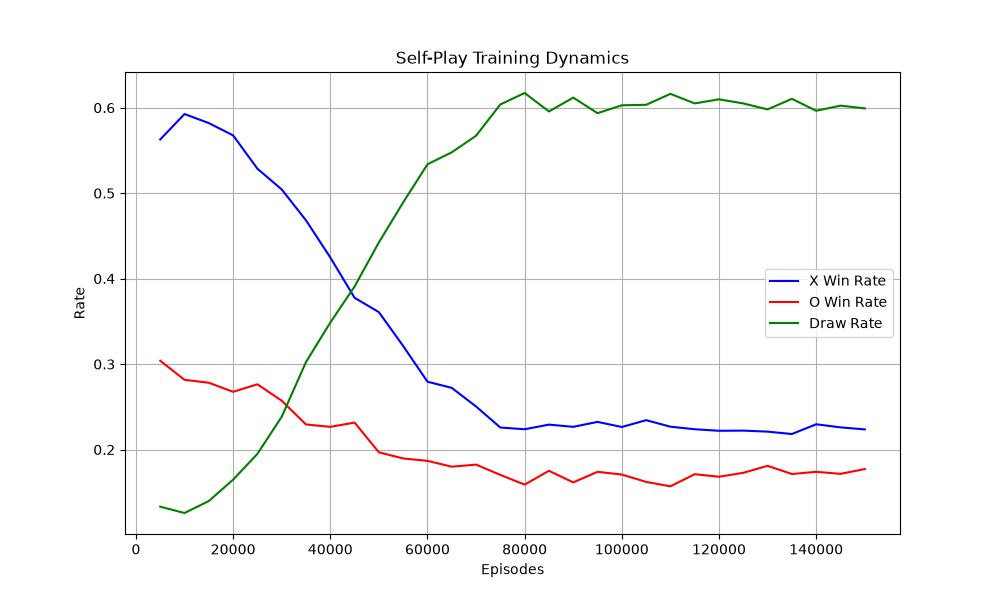

# Reinforcement Learning – Tic Tac Toe AI Agent

An optimal Reinforcement Learning agent trained via **Self-Play** using **Tabular Q-Learning** to master the game of Tic-Tac-Toe. The agent learns purely from gameplay experience and reward feedback without any hardcoded heuristic rules.

---

## Project Structure

- `env.py`: Tic-Tac-Toe environment logic (board representation & rules).
- `agent.py`: QLearningAgent implementation (Bellman updates & epsilon-greedy policy).
- `train.py`: Self-play and curriculum training pipeline.
- `play.py`: Interactive CLI game (Human vs Trained Agent).
- `evaluate.py`: Evaluation benchmark vs Random Opponent.
- `policy_x.pkl`: Trained Q-table weights for Player X.
- `policy_o.pkl`: Trained Q-table weights for Player O.
- `training_results.png`: Training win/draw progression curves.
- `README.md`: Project documentation and analysis.

---

## Performance Benchmark

Evaluation conducted over **1,000 matches** against an opponent choosing uniformly random actions:

| Metric | Agent as X (First Player) | Agent as O (Second Player) |
| :--- | :---: | :---: |
| **Agent Win Rate** | **98.50% (985/1000)** | **92.00% (920/1000)** |
| **Draw Rate** | **1.50% (15/1000)** | **8.00% (80/1000)** |
| **Loss Rate** | **0.00% (0/1000)** | **0.00% (0/1000)** |

The benchmark demonstrates **optimal policy convergence**:
- The agent achieves a **0.00% loss rate** in both playing roles.
- By incorporating a **curriculum with random exploration rounds** during self-play, the agent successfully eliminates defensive blind spots and counters unpredictable play.

---

## Training Dynamics

Below are the learning curves across 150,000 episodes:

1. **Exploration Phase (0 – 20,000 episodes):** High exploration leads to random actions, favoring the first player (X) due to turn order advantage.
2. **Tactical Learning Phase (20,000 – 75,000 episodes):** As epsilon decays, both agents learn defensive blocking strategies; draw rates surge rapidly.
3. **Equilibrium & Convergence (75,000 – 150,000 episodes):** The curves plateau. In pure self-play encounters between two competent agents, the game converges towards draws.

---

## Reward Structure Analysis

The reward structure governs terminal evaluation and shapes the strategic posture of the agent:

- **Win (+1.0):** Maximizes path values leading to victory, reinforcing decisive tactical setups.
- **Loss (-1.0):** Imposes a steep penalty that enforces critical blocking moves early in the sequence.
- **Draw (+0.1):** Prioritizes winning (+1.0) while ensuring that a draw remains significantly preferable to a loss (-1.0), preventing premature safe draws.
- **Step Transition (0.0):** Non-terminal transitions carry zero intermediate rewards, avoiding bias regarding total move count.

---

## Hyperparameter Analysis

- **Learning Rate (alpha = 0.1):** Balances old Q-values with newly observed temporal difference errors, ensuring stable updates in self-play.
- **Discount Factor (gamma = 0.95):** Essential for Tic-Tac-Toe to resolve the delayed credit assignment problem, propagating terminal rewards back to early opening moves.
- **Exploration Strategy (epsilon-greedy):**
  - **Initial epsilon = 1.0:** Promotes comprehensive exploration across all board states in early stages.
  - **Decay Rate = 0.99996:** Gradually shifts the behavior from exploration to exploitation.
  - **Minimum epsilon = 0.05:** Retains slight behavioral variety throughout self-play to maintain robust coverage of edge cases.

